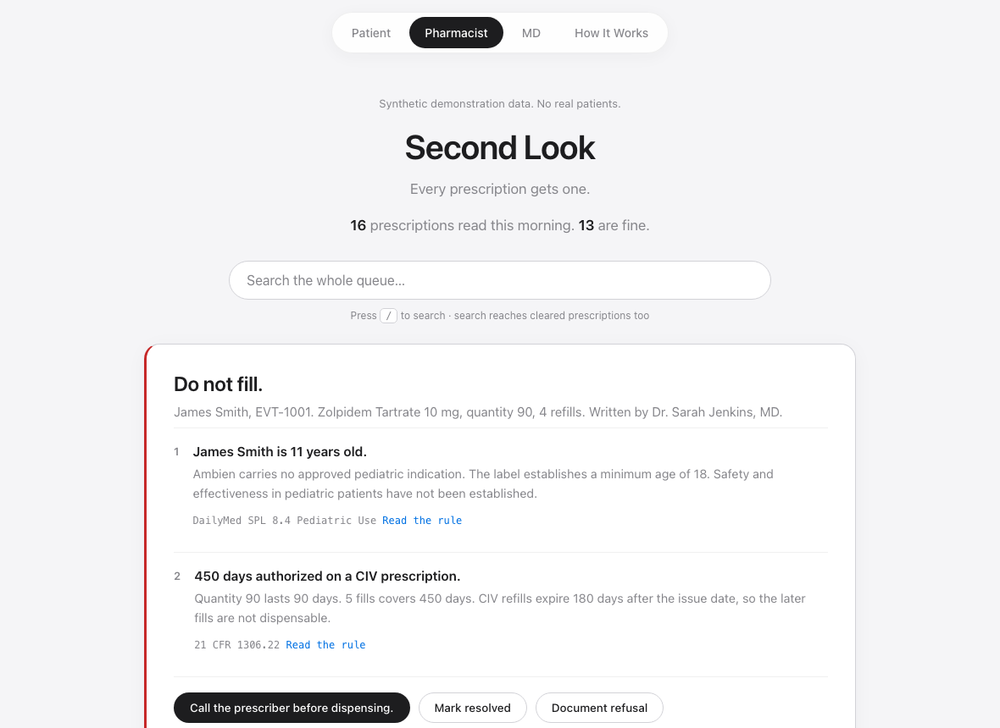
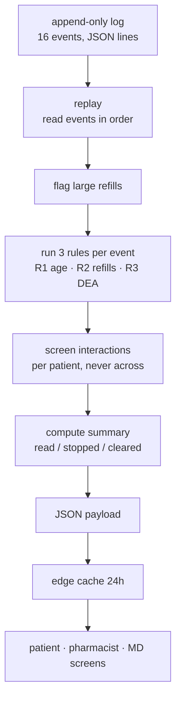
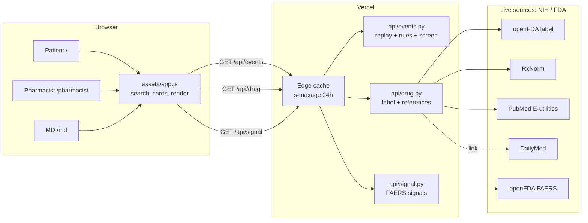

<p align="center">
  
</p>

# prescription-event-stream


[](https://prescription-event-stream.vercel.app)

A prescription safety engine. It checks each refill on the server before
any screen shows it. It checks federal dispensing rules. It screens for
drug interactions. It pulls real safety data from federal databases.

One check. Three readers. The same finding renders as plain English for
patients, a verdict with citations for pharmacists, and panel alerts for
prescribers.

**Live app:** https://prescription-event-stream.vercel.app



## What it does

- Reads a fixed queue of 16 synthetic prescriptions.
- Runs three federal rules on each one.
- Screens each patient's drugs for interactions.
- Clears 13 and stops 3, every time, with no randomness.
- Looks up any other drug live from the FDA label database.
- Mines FAERS for adverse event signals.
- Links each drug to recent PubMed studies.

The data is synthetic. No real patients. A gray line on every page says so.

## The pages

| Page | Who it serves | What it answers |
| --- | --- | --- |
| [`/`](https://prescription-event-stream.vercel.app/) | Patients and parents | Is my family okay, and what do I do today? |
| [`/pharmacist`](https://prescription-event-stream.vercel.app/pharmacist) | Pharmacists | Can I legally fill this, and why not? |
| [`/md`](https://prescription-event-stream.vercel.app/md) | Prescribers | Is anything from my panel being stopped? |
| [`/how-it-works`](https://prescription-event-stream.vercel.app/how-it-works) | Everyone | Architecture, rules, and diagrams |

Every page has live search. Type a drug, a person, or a condition. Type a
class like "benzodiazepine" or a mechanism like "dopamine". Drugs the
family does not take fall through to the live FDA label database.

## How it works

The app has two data paths. Both end as JSON that the pages render.

**The queue path is deterministic.** Same input, same output, every
request. It never calls the network. The steps:

1. Read the 16 events from an append-only log.
2. Flag large refills.
3. Run the three rules on each event.
4. Screen each patient's drugs for interacting pairs.
5. Count the results into a summary.

**The lookup path is live.** It runs when a search names a drug, and it
calls federal APIs. Vercel caches each answer at the edge for a day, so
the same search never hits the upstream twice. It feeds three cards:

- The FDA label card (openFDA, with RxNorm to fix brand names and typos).
- The FAERS signal block (adverse event statistics).
- The PubMed evidence list (recent studies).

### Data pipeline (the queue)



Replay is a fold over the log. It reads each event and runs the rules.
Reprocessing the whole queue costs only the read. The result is the same
every time, so one test proves the replay payload is byte-identical to the
old request-time pipeline.

### Full system



## The analytics

Here is every number the engine computes. None of it is hardcoded.

### Rule engine

Each rule is one function. It takes an event. It returns a finding or
nothing.

| Rule | Checks | Severity | Citation |
| --- | --- | --- | --- |
| R1 | Patient age against the label minimum | blocked | DailyMed SPL 8.4 |
| R2 | Refills and total days supply against the schedule cap | blocked | 21 CFR 1306.12, 1306.22 |
| R3 | DEA registration presence and check digit | blocked | 21 CFR 1301.13, 1306.03 |

The math is real, not a lookup:

- **R2 days supply.** It reads the sig to get doses per day. So 90 tablets
  taken twice a day is 45 days, not 90. It adds the first fill plus the
  refills, then compares to the 180 day window for the schedule.
- **R3 check digit.** Add the first, third, and fifth digits. Add twice
  the sum of the second, fourth, and sixth. The last digit of the total
  must match the seventh digit.

On the current queue it reads 16, clears 13, and stops 3:

- **R1 and R2.** James Smith, age 11, holds a 10 mg zolpidem prescription
  for 90 tablets with 4 refills. No pediatric use exists. 450 authorized
  days is past the 180 day Schedule IV window.
- **R3.** A Schedule IV tramadol prescription has no DEA number on file.
- **R3.** A Schedule IV temazepam prescription has a DEA number that fails
  its check digit.

### Interaction screen

- It runs per patient, never across the queue. An interaction is a fact
  about two drugs in one body.
- It checks every pair in each person's drugs against a known-pair table.
- Each finding carries a severity, the mechanism, a plain-language line,
  and an action.

On the current queue it finds three:

| Severity | Pair | Patient | Risk |
| --- | --- | --- | --- |
| Major | Sertraline + Tramadol | Mary Smith | Serotonin syndrome |
| Moderate | Sertraline + Ibuprofen | Mary Smith | GI bleeding |
| Moderate | Omeprazole + Warfarin | Patricia Johnson | Elevated INR |

Warfarin plus ibuprofen is a known major interaction. It never fires here.
Those two drugs belong to different people. A test proves the screen never
pairs across patients.

### FAERS signal detection

FAERS is the FDA's database of voluntary adverse event reports. The engine
asks a simple question for each drug and event: is this event reported for
this drug more often than for all drugs?

It builds a 2x2 table per event: reports with the drug and event, drug
without event, event without drug, and neither. From that table it
computes:

- **PRR**, the proportional reporting ratio, with a 95 percent confidence
  interval.
- **ROR**, the reporting odds ratio, with the same interval.
- **Chi-square**, with the Yates correction.

It flags an event as a signal only when all three hold. These are the
Evans 2001 criteria:

- PRR is at least 2.
- Chi-square is at least 4.
- There are at least 3 reported cases.

The patient card shows the flagged event, its PRR, and its case count.
The pharmacist card adds the statistic names and both intervals. A gray
line states the truth: a signal is a reporting pattern, not proof of
cause.

### PubMed evidence

- Each card lists up to five recent reviews and clinical trials for the
  drug.
- They come from PubMed through NCBI E-utilities.
- Each links to its PubMed page.
- The references ride on the same `/api/drug` response and its one day
  edge cache, so repeat queries never re-hit NCBI.

### Queue summary

- read, stopped, cleared, blocked, and total findings.
- A test asserts `cleared == read - stopped`.

## Performance

The deployed queue is 16 events. To test the engine under load, a script
builds a queue up to a hundred thousand events and times the full rule
engine plus the interaction screen.

```bash
python3 scripts/benchmark.py    # runs at 1k, 10k, and 100k events
```

A representative run on one 2.30 GHz Intel Xeon core, Python 3.11:

| Events | Seconds | Events per second | p50 ms | p95 ms | p99 ms |
| --- | --- | --- | --- | --- | --- |
| 1,000 | 0.007 | 149,763 | 0.0010 | 0.0135 | 0.0301 |
| 10,000 | 0.049 | 202,774 | 0.0010 | 0.0126 | 0.0217 |
| 100,000 | 0.686 | 145,871 | 0.0010 | 0.0125 | 0.0208 |

Per-event time stays flat as the queue grows a hundredfold. That is the
point. Each event is checked on its own. The interaction screen runs only
inside each patient's short drug list. So total work grows in a straight
line with the number of events.

The synthetic generator is deterministic. The same seed gives the same
queue. A planned share of events trips each rule, so the benchmark tests
the full engine, not just the clear path.

## Medication knowledge

Every drug answers the questions a patient asks:

- **Approved to treat.** The FDA-approved uses.
- **Common off-label uses.** Stated plainly, including "none" when that is
  the truth.
- **Drug class.** Benzodiazepine, SSRI, statin, ACE inhibitor.
- **How it works.** The mechanism in one sentence.

There are two data tiers, stated plainly:

- The family's 16 drugs are hand-written for easy reading.
- Every other drug comes from the live FDA label, trimmed to full
  sentences but never reworded, with a link to the full label on DailyMed.

The PubMed evidence list sits on top of both tiers. The tiers do not
change. The study links are a separate layer.

## Design decisions

- **Nothing on screen is hardcoded.** Every count comes from the payload.
- **Verdict first, evidence second.** The pharmacist page leads with "Do
  not fill." and numbers its reasons, each with a citation link. Red is
  only for blocked. If everything is red, nothing is.
- **One object, three readers.** A rule writes all three messages at once.
  The surfaces cannot drift apart.
- **Data honesty.** The app makes no security claim. The data is
  synthetic and says so.
- **No framework.** Four static pages. One stylesheet. One script. There
  is no build to fail.

## Quick start

```bash
python3 scripts/serve.py 8099    # static pages + APIs on :8099
```

```bash
python3 -m unittest discover -s tests    # 87 tests
```

```bash
python3 scripts/benchmark.py    # throughput and latency table
```

CI runs the full suite on every push. The tests cover the pipeline, all
three rules, the clinical math, the DEA checksum, the interaction screen
and its cross-patient guard, the queue summary, the live label shaping,
the FAERS statistics, the PubMed parsing, and the event log replay. Every
test uses canned fixtures. The suite never needs a network.

## Project structure

```
api/events.py            serves the evaluated queue by log replay
api/drug.py              live FDA label lookup plus PubMed references
api/signal.py            FAERS disproportionality signals
src/ingestion.py         the synthetic roster, 16 events
src/event_log.py         append-only log and idempotent replay
src/transform.py         evaluates events, shapes the payload
src/rules/               one file per rule plus the interaction screen
src/faers.py             FAERS contingency tables and statistics
src/pubmed.py            PubMed E-utilities client and shaping
src/drug_lookup.py       RxNorm plus openFDA client and label shaping
src/constants/           age floors, schedule caps, thresholds, pairs
assets/                  shared stylesheet and search and render helpers
scripts/                 local server, synthetic generator, benchmark
index.html, pharmacist/, md/, how-it-works/    the four surfaces
tests/                   unittest suite, run by CI on every push
docs/                    diagrams and screenshots used here
```

## Deployment

Deploys on Vercel with zero config. Static files from the project root.
`api/*.py` as Python serverless functions. No build step. No environment
variables.
